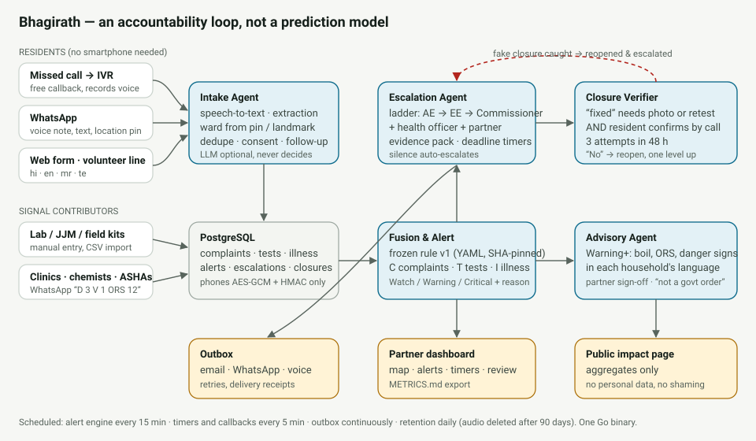
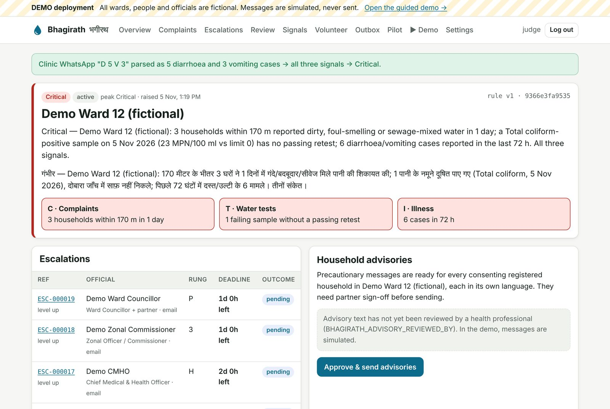
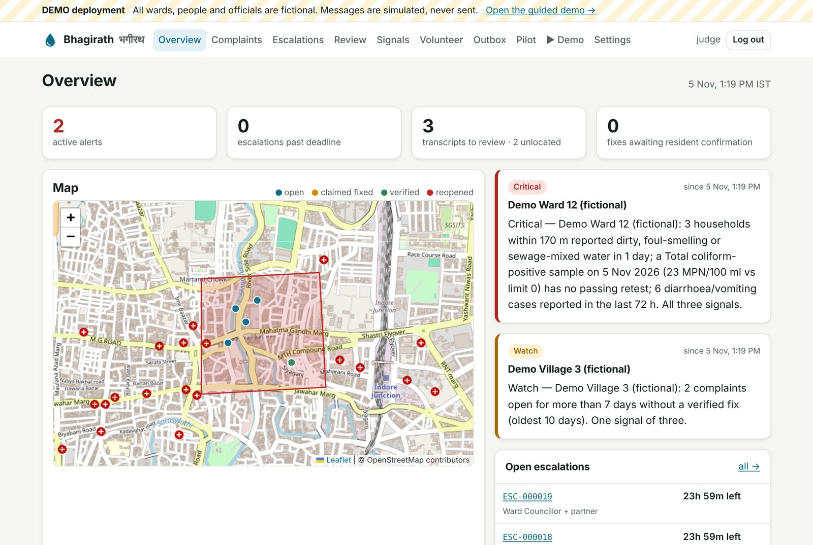
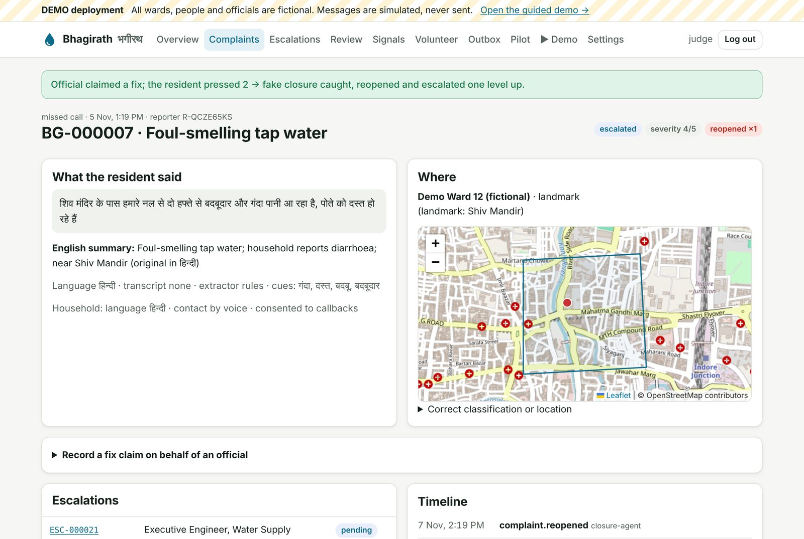
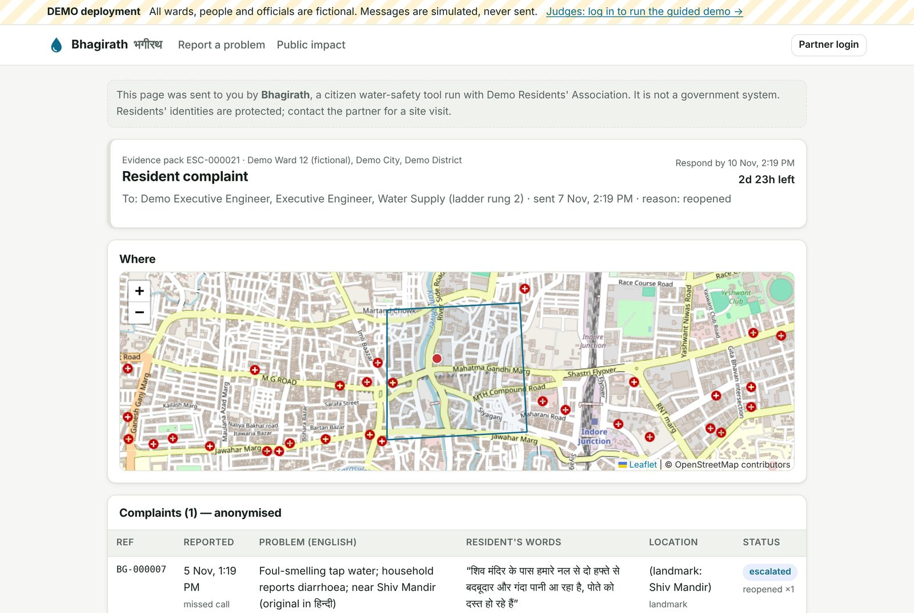
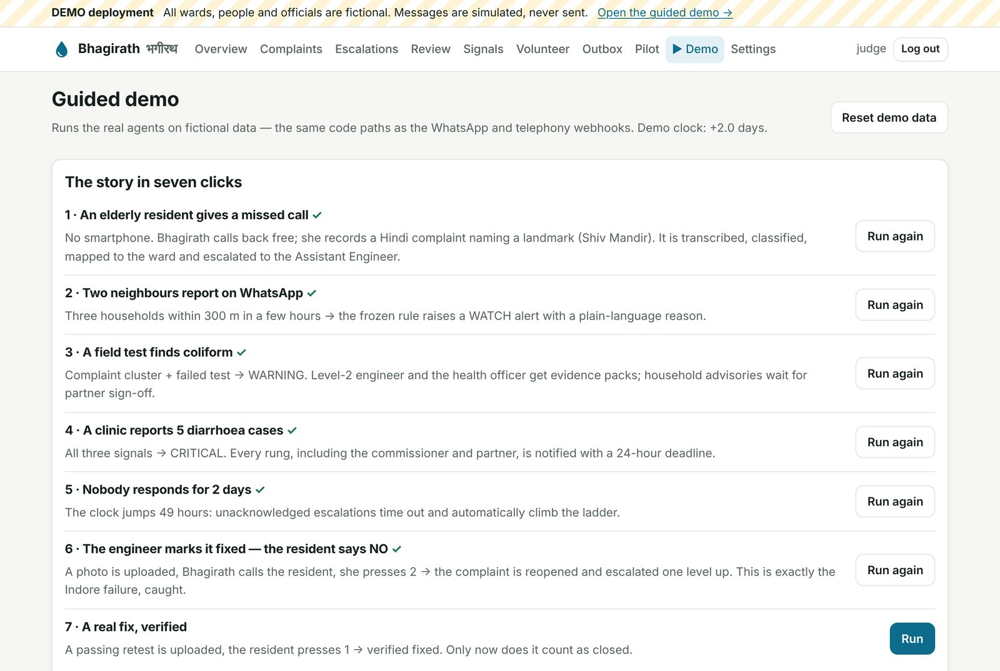
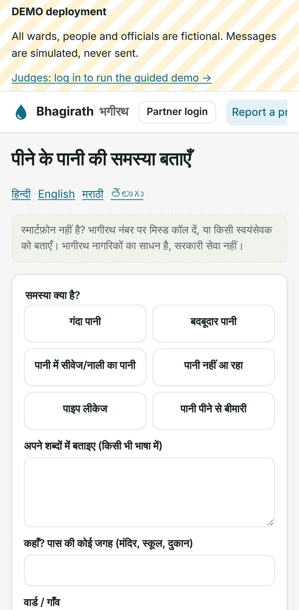

# Bhagirath · भगीरथ

**Dirty-water complaints that cannot be closed without proof.**

Bhagirath connects citizen complaints about dirty water, water-test results and early illness signals in one place. It escalates to the responsible officials with an evidence pack and a deadline, and it counts a problem as fixed only when there is evidence *and* the resident confirms it. Residents can report by missed call, IVR voice note, WhatsApp or a web form, in Hindi, English, Marathi or Telugu. No smartphone is needed.

> **Bhagirath is not a prediction model. It is an accountability loop.**
> complaint → fused alert → escalation → verified fix

**Track:** 05 — Clean Water · Code for a Billion — Bharat Agentic-AI Hackathon 2026 · **License:** Apache-2.0

| | |
|---|---|
| Live demo | `⚠ TODO: add deployed URL` (demo login: `judge` / see submission) |
| Demo video | `⚠ TODO: add video link` |
| Backtest | [backtest/REPORT.md](backtest/REPORT.md) — frozen rule replayed on four documented outbreaks |
| Pilot metrics | [pilot/METRICS.md](pilot/METRICS.md) — exported from the database |

---

## At a glance, against the judging criteria

| Criterion | Evidence |
|---|---|
| **Size of the problem** | 1,61,062 of 63,96,035 drinking-water samples tested contaminated in 2025-26 (Rajya Sabha Unstarred Q.1859). The CAG found 8.95 lakh residents of Bhopal and Indore received contaminated water (Report No. 3 of 2019). Bhagirath is configured per ward or village and works for any one of them. |
| **Severity** | Bhagirathpura, Indore: at least 16 deaths after months of ignored complaints; 434 people admitted to hospital by 12 Jan 2026 ([Deccan Herald/PTI](https://www.deccanherald.com/india/madhya-pradesh/indore-water-contamination-12-new-cases-of-diarrhoea-detected-over-4800-people-screened-3859863)). |
| **Quality of the solution** | Five agents covering intake, fusion, escalation, verified closure and advisory. It works without a smartphone. The alert rule is frozen and auditable, backtested honestly and CI-checked. Tests cover rule edges, the full loop, concurrency, security and reproducibility. |
| **Proven impact** | Field numbers are exported from the database to [pilot/METRICS.md](pilot/METRICS.md) and are never typed by hand. The backtest shows a 23-day lead on Indore under the most conservative reading. |

## Why

In late December 2025, sewage-contaminated drinking water caused a diarrhoea outbreak in Bhagirathpura, Indore. About 150 people fell ill in the first week ([Aaj Tak](https://www.aajtak.in/madhya-pradesh/story/indore-bhagirathpura-contaminated-water-illness-deaths-lclar-strc-2426693-2025-12-30)), and at least 16 died ([Times of India](https://timesofindia.indiatimes.com/city/delhi/indore-water-tragedy-fallout-delhi-jal-board-ordered-to-intensify-quality-checks-dedicated-teams-to-monitor-high-density-areas/articleshow/126387877.cms)). Residents had complained about dirty water for months, on the 311 Mayor Helpline and to the CM Helpline: 11 complaints came from Bhagirathpura alone. About 700 such complaints in Indore sat "under resolution", and of 100 dirty-water CM Helpline complaints from the city, 80 were pending at Assistant Engineer level ([Dainik Bhaskar](https://www.bhaskarenglish.in/local/mp/news/indore-water-contamination-complaints-failed-to-trigger-action-appeals-made-mayor-helpline-cm-before-deaths-136854510.html)). Nationally, 1,61,062 of 63,96,035 drinking-water samples tested contaminated in 2025-26 (Rajya Sabha Unstarred Q.1859, 9 Mar 2026; [New Indian Express](https://www.newindianexpress.com/india/2026/Mar/09/161-lakh-water-sample-found-contaminated-across-the-country-in-2025-26-minister-somanna-informs-rs)).

The data needed to prevent these deaths already existed, but in three places nobody connected — **complaints** (helplines), **water tests** (labs), **illness** (clinics) — and nobody was made to close the loop with proof.

## What it does



| Agent | What it decides or does |
|---|---|
| **Intake** | Transcribes voice notes (Sarvam ASR, or a volunteer review queue), classifies the problem from text in Hindi, English, Hinglish, Marathi, Telugu, Tamil, Bengali, Gujarati or Kannada, resolves the ward from a GPS pin, a spoken landmark or a registered address, links same-household repeats, asks for consent and a follow-up location, and acknowledges the resident. |
| **Fusion & Alert** | Applies the **frozen, deterministic rule** ([config/alert_rule_v1.yaml](config/alert_rule_v1.yaml)) to each ward every 15 minutes and after every new signal. Raises **Watch / Warning / Critical** with a plain-language reason in English and Hindi. |
| **Escalation** | Picks officials from the ladder (AE → EE → Commissioner, plus health officer and partner), sends an evidence pack with a deadline (72 / 48 / 24 h) and escalates automatically on silence. Officials can acknowledge with one tap on WhatsApp. It also escalates complaints that were acknowledged but never fixed. Officials who can only be reached through a grievance portal become a partner task with a tracked grievance number. |
| **Closure Verifier** | A "fixed" claim needs a repair photo or a passing retest; a contaminated retest is rejected. Bhagirath then calls the resident in their language ("press 1 if fixed, 2 if not"), with three attempts over 48 h. A **"no" or no answer reopens the complaint and escalates it one level up** — the fake-closure catch that Indore needed. |
| **Advisory** | At Warning or higher, after partner sign-off, sends precautionary advice to every consenting household in its own language: boil water, ORS, danger signs, how to report. Each message is labelled *"not an official government order"*. In pilot mode it refuses to send until a health professional's review is recorded. |

**AI is used where it helps and kept away from where it must not decide.** Transcription, extraction and translation may use a speech or language model, and its output is validated against fixed enums with a deterministic fallback. Alert levels come only from the published rule. That keeps the system auditable and the backtest honest.

## Screens

| | |
|---|---|
|  **Critical alert:** each signal, its reason in English and Hindi, and the ladder with live deadlines |  **Overview:** the ward map, active alerts and open escalations |
|  **Fake closure caught:** an official claimed a fix, the resident pressed 2, and the complaint was reopened and escalated |  **Official's link:** the evidence pack, acknowledgement, and a fix claim with photo or retest |
|  **Guided demo:** the story in seven clicks |  **Report form** in four languages, built for cheap phones |

## The alert rule (v1, frozen)

Per ward, over rolling windows ([full YAML](config/alert_rule_v1.yaml)):

- **C — complaints:** ≥3 dirty/smelly/sewage complaints from ≥3 households, all within 300 m of each other, in 14 days; **or** any such complaint open more than 7 days without a *verified* fix.
- **T — tests:** a contaminated sample in the last 30 days with no later passing retest of the same parameter.
- **I — illness:** ≥3 diarrhoea/vomiting cases in 72 h, or a chemist's ORS sales at least 2× its own 4-week average.
- **Watch** = one signal · **Warning** = two · **Critical** = all three, or illness plus C or T with ≥5 cases.

Every open question in the spec is settled in the file, always conservatively. Examples: the 300 m condition is pairwise, unlocated complaints never cluster, anonymous complaints count as one household, and a patient counted under both diarrhoea and vomiting counts once.

The rule was committed in `d005214` (branch [`freeze/rule-v1`](https://github.com/vivekyarra/bhagirath/tree/freeze/rule-v1); tag `rule-v1-frozen`) **before any outbreak data was collected**. Its SHA-256 is pinned in code, so the server will not start with an edited v1 and CI fails if the file changes.

## Backtest: would it have warned in time?

The production rule was replayed over sourced timelines ([REPORT.md](backtest/REPORT.md), [RESULTS.md](backtest/RESULTS.md)):

- **Indore, Bhagirathpura.** Using only the three individually dated 2025 helpline complaints, each at its latest plausible date, the rule raises a **Watch on 27 Nov 2025**. If nobody responded, the commissioner would have had the evidence pack by **3 Dec 2025** — **23 days before the first claimed death** and 31 days before the first corroborated one. With all the complaint evidence, the lead time is far longer.
- **Honest limits:** the multi-signal alerts (Warning, Critical) fire only in the week the outbreak began, because no dated pre-outbreak test exists. For Shimla 2015-16 (jaundice), Gandhinagar 2026 (typhoid) and a Greater Noida control, the public data would **not** have produced an early warning. The report explains what minimum data would have been needed.

CI regenerates `RESULTS.md` from the data and the frozen rule on every commit and fails if it changes.

## Pilot

Field results are exported from the database to [pilot/METRICS.md](pilot/METRICS.md) with `bhagirath export-metrics`, including the export date. Nothing is hand-counted. The playbook for running the pilot — consent script, baseline interviews, clinic onboarding and a printable flyer — is in [docs/PILOT_PLAYBOOK.md](docs/PILOT_PLAYBOOK.md).

## Try it

### Demo deployment (judges)

Log in as `judge` and open **▶ Demo**. Seven clicks run the whole story on fictional data, using the same code paths as the real webhooks:

1. an elderly resident gives a **missed call** and records a Hindi complaint;
2. two neighbours report on WhatsApp → **Watch**;
3. a field test finds coliform → **Warning**, advisories wait for sign-off;
4. a clinic reports 5 cases → **Critical**, every rung notified;
5. the clock jumps 49 h → unanswered escalations **climb the ladder**;
6. the engineer marks it fixed with a photo → the resident presses **2** → **reopened and escalated**;
7. a passing retest, and the resident presses **1** → **verified fixed**.

You can also open any official's evidence-pack link from the Outbox, correct a transcript in the Review queue, or see the public **Impact** page.

### Run locally

Prerequisites: Docker, or Go 1.26+ with PostgreSQL 16.

```bash
cp .env.example .env
```

```bash
docker compose up --build
```

Open http://localhost:8080. In demo mode, fictional seed data loads on first start; log in as `judge` / `water-judge-2026`, or set `BHAGIRATH_JUDGE_PASSWORD`.

Without Docker:

```bash
go build -o bin/bhagirath ./cmd/bhagirath
```

```bash
DATABASE_URL=postgres://localhost/bhagirath?sslmode=disable ./bin/bhagirath serve
```

### Commands

```bash
bhagirath serve              # web + scheduled agents (default)
bhagirath migrate            # apply migrations
bhagirath seed               # demo only: reset and seed fictional data
bhagirath backtest           # regenerate backtest/RESULTS.md from the frozen rule
bhagirath export-metrics     # write pilot/METRICS.md from the database
bhagirath create-user NAME ROLE   # admin | partner | judge | viewer; password on stdin
```

### Tests

```bash
make check    # gofmt, go vet, staticcheck, race-enabled tests against Postgres
```

The tests cover every alert level and edge of the rule, including a property test against brute force; the full accountability loop end to end; no-answer and field-visit verification; ack-without-fix escalation; concurrent intake stress under `-race`; HTTP auth, CSRF and roles; webhook signatures (including Twilio's documented vector); official links; a byte-for-byte reproducibility check of the backtest; and the safety content of every advisory translation.

### Going live (pilot mode)

Set `BHAGIRATH_MODE=pilot`. The server refuses to start without a real `BHAGIRATH_SECRET_KEY`, a strong admin password and a non-example ladder file. Copy [config/ladder.example.yaml](config/ladder.example.yaml) to `config/ladder.local.yaml` (git-ignored) and fill in the partner's ward boundary, landmarks and officials from public sources. Channel setup for WhatsApp, Twilio, Exotel and email is in [docs/CHANNELS.md](docs/CHANNELS.md); hosting on Render, Fly.io or any Docker host is in [docs/DEPLOY.md](docs/DEPLOY.md).

## How it was built

The service is a single Go binary: `net/http`, `pgx`, server-rendered templates and a vendored Leaflet map. There is no Node toolchain and no framework, and it is fast on 2G phones. PostgreSQL holds all state, and spatial logic runs in Go so that the live system and the backtest share one code path. Development happened in reviewed pull requests, each with CI running formatting, vet, staticcheck, race tests, govulncheck and a Docker smoke test.

**AgentFoundry:** `⚠ TODO (team): describe the AgentFoundry project, link screenshots in docs/screenshots/, and list collaborators invited there.`

## Privacy & safety

- **Consent first.** The first contact explains callbacks; a "no" deletes the stored number. Unanswered consent requests are purged after 24 h.
- **Phone numbers** are stored only as AES-256-GCM ciphertext (for consented callbacks) and an HMAC (to count distinct households). Dashboards show `R-XXXXXXXX` references; plain numbers never appear in the database, logs or exports.
- **Officials' links** carry 256-bit tokens; only their hashes are stored, and delivered links are scrubbed from the outbox.
- **Illness signals are counts, never patient records.** No diagnosis is given.
- **No impersonation.** Every resident message says Bhagirath is a citizen tool, not the government. Officials receive factual, polite messages. The public page shows ward-level aggregates and never names an official.
- **Retention.** Voice recordings are deleted after 90 days (configurable); the metadata is kept for audit. Every action is in an append-only audit log.
- **Advisory text** must be reviewed by a doctor or public-health professional before a pilot sends it. Reviewer: `⚠ TODO: name, role` (recorded in `BHAGIRATH_ADVISORY_REVIEWED_BY`).
- **Repository hygiene.** Only fictional seed data (`+9100000xxxxx`); no real numbers, audio or residents' names. Names of private individuals are redacted from the backtest sources.
- **Web security.** CSRF on every form, signed sessions, role-based access, a strict CSP, rate limits, a honeypot on the public form, signature checks on WhatsApp and Twilio webhooks, and an SSRF guard on recording downloads.

## Repository map

```
cmd/bhagirath/        single binary: serve, migrate, seed, backtest, export-metrics
config/               alert_rule_v1.yaml (FROZEN), ladder.example.yaml (fictional)
internal/rule         deterministic alert engine (shared by production and backtest)
internal/agents       intake, fusion, escalation, closure verification, advisory
internal/store        PostgreSQL persistence, metrics queries
internal/web          dashboard, public pages, official links, webhooks, simulator
internal/…            asr, extract, lang, locate, i18n, whatsapp, telephony, notify, secure
backtest/             sourced timelines, REPORT.md, generated RESULTS.md
pilot/                METRICS.md exported from the database
docs/                 architecture, channels, deploy, pilot playbook, flyer, submission draft
```

## Team

`⚠ TODO: names and roles` · Pilot partner: `⚠ TODO` · Contributions welcome — see [CONTRIBUTING.md](CONTRIBUTING.md).

## Sources

- Dainik Bhaskar English — complaints before the Indore deaths: https://www.bhaskarenglish.in/local/mp/news/indore-water-contamination-complaints-failed-to-trigger-action-appeals-made-mayor-helpline-cm-before-deaths-136854510.html
- Aaj Tak, 30 Dec 2025 — about 150 ill: https://www.aajtak.in/madhya-pradesh/story/indore-bhagirathpura-contaminated-water-illness-deaths-lclar-strc-2426693-2025-12-30
- Times of India, 7 Jan 2026 — at least 16 deaths: https://timesofindia.indiatimes.com/city/delhi/indore-water-tragedy-fallout-delhi-jal-board-ordered-to-intensify-quality-checks-dedicated-teams-to-monitor-high-density-areas/articleshow/126387877.cms
- Rajya Sabha Unstarred Question 1859, 9 Mar 2026, and New Indian Express coverage: https://www.newindianexpress.com/india/2026/Mar/09/161-lakh-water-sample-found-contaminated-across-the-country-in-2025-26-minister-somanna-informs-rs
- CAG Report No. 3 of 2019 (Madhya Pradesh), water supply management in Bhopal and Indore: https://cag.gov.in/uploads/download_audit_report/2019/(10)%20Chapter-II%20PA%20on%20WSM-05f96ba7abda563.27223354.pdf
- Jal Jeevan Mission WQMIS (Citizen Corner): https://ejalshakti.gov.in
- Every backtest source with quotes: [backtest/RESEARCH_NOTES.md](backtest/RESEARCH_NOTES.md)
